<!-- header:start -->
<div align="center">


<a href="#-quick-start"></a>

<a href="LICENSE"></a>

<a href="https://github.com/ajendras/lumagen/stargazers"></a>
<a href="https://github.com/ajendras/lumagen/actions/workflows/ci.yml"></a>

<a href="CONTRIBUTING.md"></a>

**AI-powered editor that turns natural language into tiny self-contained WebGPU generative scenes**

[✨ Features](#-features) • [⚡ Quick start](#-quick-start) • [🧰 Usage](#-usage) • [🧩 Architecture](#-architecture) • [📍 Roadmap](#-roadmap) • [🤝 Contributing](#-contributing)

</div>
<!-- header:end -->

## ✨ Why Lumagen?

Viral single-file WebGPU demos like Abyssal Garden inspire many, yet creating them demands deep graphics and shader expertise. Lumagen fills the gap with a friendly pastel UI, local-LLM scene generation, live preview, and one-click export to optimized standalone HTMLs. Perfect for digital artists, indie devs and educators prototyping immersive procedural experiences.

- **Local-first AI** — `generateScene()` turns natural language into WGSL + uniforms via Ollama (with rich fallback when unavailable)
- **Instant live preview** — tweak sliders or regenerate and see changes reflected immediately via `createPipeline()` and the render loop
- **Tiny standalone exports** — `exportToHTML()` produces dependency-free HTMLs under 100 KB that run anywhere WebGPU is supported
- **Creative velocity** — start from the pastel `galleryTemplates`, remix specific aspects, and copy shader/JS blocks with one click

## 🎬 Demo

<p align="center"></p>

## 🚀 Features

<table>
<tr>
<td width="33%" valign="top">
🌐 <b>AI Scene Gen</b><br>
Converts plain-English prompts into complete WGSL shaders, JS logic and uniform metadata via Ollama
</td>
<td width="33%" valign="top">
⚡ <b>Live Preview</b><br>
Real-time WebGPU canvas that instantly reflects prompt changes, uniform tweaks and animation updates
</td>
<td width="33%" valign="top">
📦 <b>One-File Export</b><br>
Bundles scene into a single dependency-free HTML under 100 KB ready for sharing or embedding
</td>
</tr>
<tr>
<td width="33%" valign="top">
🎛️ <b>Smart Controls</b><br>
Auto-generates pastel sliders, color pickers and toggles for every uniform the AI exposes
</td>
<td width="33%" valign="top">
🖼️ <b>Template Gallery</b><br>
Curated starters including kelp forests, sunbeams, particle fields and fractal explorers
</td>
<td width="33%" valign="top">
📊 <b>Perf Monitor</b><br>
Built-in FPS counter, draw-call stats and GPU timing to keep scenes running smoothly
</td>
</tr>
<tr>
<td width="33%" valign="top">
🔄 <b>Partial Remix</b><br>
Regenerate only lighting, motion or color via targeted prompts while preserving the rest
</td>
<td width="33%" valign="top">
📋 <b>Copy Blocks</b><br>
One-click extraction of shader, JS or full HTML for quick iteration in any editor
</td>
</tr>
</table>

## 📦 Installation

**Requirements**

- Node.js 18+
- Ollama running locally with the `llama3.2` model (for full AI generation; rich fallback shader is used otherwise)
- Chrome/Edge 113+ (or any browser with WebGPU enabled)

```bash
npm install
npm run dev
```

Open http://localhost:5173. The pastel UI will appear with a live WebGPU canvas.

To prepare a production build:

```bash
npm run build
npm run export
```

## ⚡ Quick start

```html
<!DOCTYPE html>
<html>
<head>
  <script type="module">
    import { startEditor, exportCurrentScene } from './src/main.ts';
    
    window.addEventListener('load', async () => {
      await startEditor();
      // Type a prompt like "gentle underwater kelp forest" and click Generate
      // Export with one click:
      // exportCurrentScene();
    });
  </script>
</head>
<body>
  <div id="root"></div>
</body>
</html>
```

The call to `startEditor()` wires the entire pastel UI, GPU context, prompt handler and render loop.

## 🧰 Usage

### Generate a scene from a prompt

```ts
import { generateScene } from './src/ai/client.ts';
import { createPipeline, writeUniforms } from './src/gpu/pipeline.ts';

const scene = await generateScene(
  'ethereal glowing neon garden at twilight with floating orbs'
);
const pipeline = await createPipeline(scene.wgsl, scene.uniforms);
// render loop automatically calls writeUniforms(time)
```

### Load a gallery template

```ts
import { getGalleryTemplates, getRandomTemplate } from './src/gallery.ts';
import { parseLLMOutput } from './src/scene/parser.ts';

const templates = getGalleryTemplates();
const random = getRandomTemplate();
const scene = parseLLMOutput(`\`\`\`wgsl\n${random.prompt}\n\`\`\``); // demo path
```

### Export a standalone HTML

```ts
import { exportToHTML } from './src/exporter.ts';

const html = await exportToHTML(scene, 'My Neon Garden');
console.log(`Exported ${calculateSize(html)} KB file`);
```

<details><summary>Advanced: Partial remix while preserving uniforms</summary>

```ts
import { remixScene } from './src/scene/parser.ts';

const updated = remixScene(currentScene, {
  wgsl: newLightingWGSL,           // only replace lighting
  uniforms: currentScene.uniforms  // keep existing controls
});
await createPipeline(updated.wgsl, updated.uniforms);
```

</details>

<details><summary>Advanced: Manual uniform updates with live feedback</summary>

```ts
import { updateUniformBuffer } from './src/gpu/pipeline.ts';
import { updateSliderValue } from './src/ui/panel.ts';

updateUniformBuffer('hueShift', 0.82);
updateSliderValue('hueShift', 0.82); // UI stays in sync
```

</details>

## 🧩 Architecture

```mermaid
flowchart TD
    Prompt[Prompt textarea] --> bindPromptHandler
    bindPromptHandler --> generateScene[ai/client.ts → queryOllama]
    generateScene --> parseLLMOutput[scene/parser.ts]
    parseLLMOutput --> Scene[Scene {wgsl, uniforms, jsLogic, title}]
    Scene --> createPipeline[gpu/pipeline.ts]
    Scene --> populateUniforms[ui/panel.ts]
    createPipeline --> RenderLoop[main.ts render loop]
    RenderLoop --> writeUniforms[gpu/pipeline.ts]
    Scene --> exportToHTML[exporter.ts + minifier.ts]
    gallery.ts --> populateMiniGallery & populateFullGallery
    style Scene fill:#f9e7f0,stroke:#f472b6
```

`main.ts` bootstraps the WebGPU context, UI panels and render loop. Natural-language prompts flow through the Ollama client and parser into a typed `Scene`. The GPU layer compiles the WGSL and maintains a dynamic uniform buffer. The exporter inlines everything into a self-contained HTML.

## 📁 Project structure

```text
.
├── package.json                 # Vite, Tailwind, TypeScript, Vitest + "dev", "build", "test", "export" scripts
├── vite.config.ts               # HMR, WebGPU worker support, template.html plugin
├── tailwind.config.ts           # Pastel palette (#f472b6, #67e8f9), Nunito font, rounded-3xl
├── index.html                   # Entry with Tailwind and root canvas
├── src/
│   ├── main.ts                  # Bootstrap, startEditor(), exportCurrentScene(), render loop
│   ├── ai/
│   │   └── client.ts            # Ollama HTTP client + SYSTEM_PROMPT + fallback shader
│   ├── scene/
│   │   └── parser.ts            # parseLLMOutput(), validateWGSL(), remixScene()
│   ├── gpu/
│   │   ├── context.ts           # init(), resizeHandler(), GPUContext
│   │   └── pipeline.ts          # createPipeline(), updateUniformBuffer(), writeUniforms()
│   ├── ui/
│   │   └── panel.ts             # createUniformSlider(), bindPromptHandler(), populateUniforms(), gallery
│   ├── exporter.ts              # exportToHTML() + self-contained runtime template
│   ├── gallery.ts               # galleryTemplates array + getRandomTemplate(), findTemplateByTitle()
│   └── utils/
│       └── minifier.ts          # minifyJS(), calculateSize()
└── tests/
    └── parser.test.ts           # Vitest suite for parseLLMOutput, uniform extraction, WGSL validation
```

## 🧪 Testing

```bash
npm test
```

Runs the Vitest suite in `tests/parser.test.ts`. Covers `parseLLMOutput()` edge cases, uniform extraction from JSON blocks, title derivation, and `validateWGSL()` syntax/structure checks on mocked LLM responses.

## 📍 Roadmap

<!-- roadmap:start -->
- [x] **v0.1.0** — first release: AI Scene Gen, Live Preview, One-File Export, Smart Controls
- [ ] Add WebAudio reactive mode so scenes respond to microphone or track FFT data
- [ ] Implement 'remix this part' button that sends current shader back to LLM with a targeted edit prompt
- [ ] Add static analysis step that catches common WGSL errors before attempting to compile
- [ ] Build public community gallery site where exported HTMLs can be uploaded and remixed
- [ ] Support compute shaders and multi-pass rendering for more complex effects
- [ ] Add few-shot examples to the system prompt to improve shader quality on first try
- [ ] Create undo/redo stack for prompt iterations and parameter adjustments
- [ ] Optimize exporter with Brotli compression reporting and size budget warnings
- [ ] Add mobile touch-friendly canvas gestures for rotating or zooming procedural cameras
- [ ] Provide a small library of reusable WGSL noise/SDF helpers that LLM is instructed to import
- [ ] Electron wrapper for offline desktop app with direct llama.cpp integration
- [ ] Plugin API for custom post-processing effects contributed by the community

> 🤖 This roadmap is worked through continuously — ideas and PRs welcome!
<!-- roadmap:end -->

## 🤝 Contributing

We'd love your help making Lumagen even friendlier! Please read [CONTRIBUTING.md](https://github.com/ajendras/lumagen/blob/main/CONTRIBUTING.md) and follow our [CODE_OF_CONDUCT.md](https://github.com/ajendras/lumagen/blob/main/CODE_OF_CONDUCT.md).

Good-first-issue PRs are especially welcome — improving gallery templates, adding new uniform widget types, or tightening the minifier are all great places to start. Just open a PR against `main` and we'll review it quickly.

## 📄 License

[MIT License](https://github.com/ajendras/lumagen/blob/main/LICENSE) — feel free to use Lumagen in both personal and commercial projects.

<!-- footer:start -->
<div align="center">

### ⭐ Star history

<a href="https://star-history.com/#ajendras/lumagen&Date"></a>

If **Lumagen** saves you time, a ⭐ helps others find it.

Made with ❤️ by [Ajendra](https://ajendra.info)


</div>
<!-- footer:end -->
